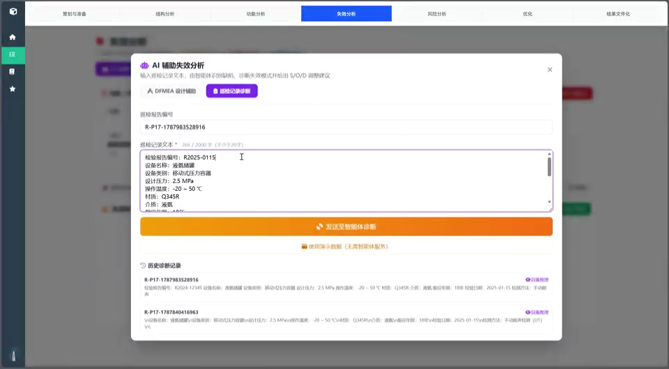
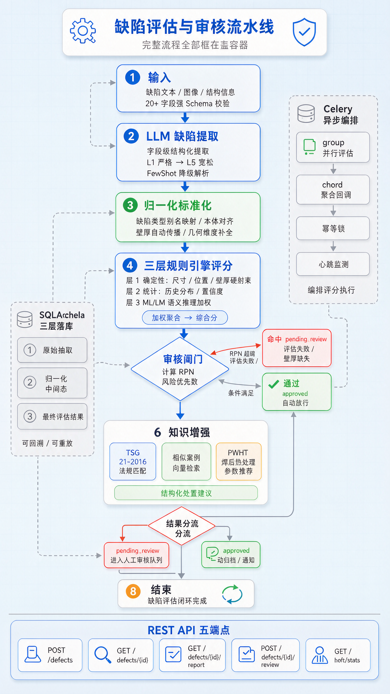
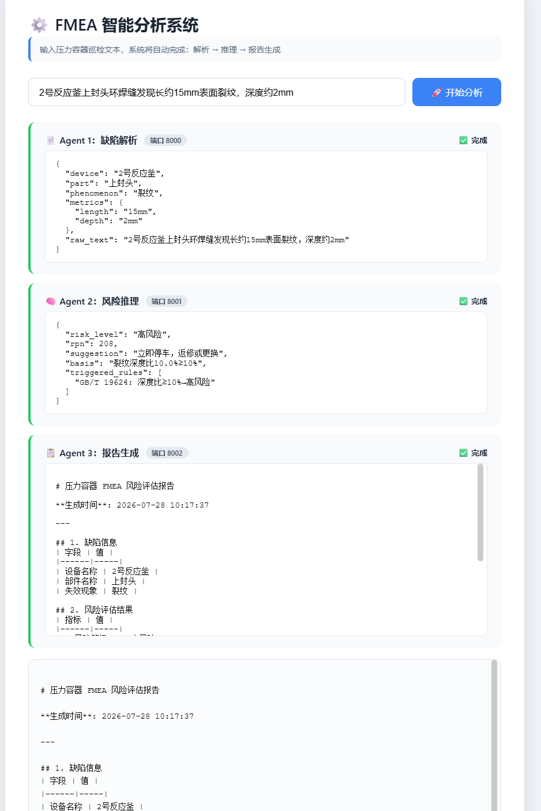

# Pressure Equipment FMEA Intelligent Assessment System

> A cleaned portfolio snapshot of a 2026 China Jiliang University "Challenge Cup" student team project.

This repository contains the FastAPI/CrewAI-based intelligent assessment engine for pressure-equipment FMEA evaluation. The project explores a safety-critical AI design in which an LLM is used only for information extraction, while risk scoring and human-review decisions remain deterministic and auditable.

[](docs/videos/fmea_demo.mp4)

*2.5-minute demo: DFMEA workflow, AI-assisted failure analysis, RPN evaluation, and human-review screens.*

## Project context

- **Institution:** China Jiliang University, College of Management Science and Engineering
- **Competition:** 2026 China Jiliang University "Challenge Cup" student innovation competition (university-level), Technology Invention Category B
- **Team:** 10 undergraduate students
- **First author / project lead:** He Xinlong
- **Faculty advisors:** Zeng Qiyong and Chen Jiayan, Associate Professors
- **Project stage:** Laboratory prototype with internal end-to-end demonstration

## My contribution

I am **Liu De'en**, a team member from the Standardization Engineering program (Class of 2024). My work focused on:

- Building and configuring the AI agent workflow
- Backend development for the intelligent assessment service
- RPN analysis logic and risk-scoring workflow implementation
- Collecting and structuring standards, regulations, and reference materials used by the assessment engine

Code and project materials documenting this work are included in this repository. The repository is a team-project snapshot and does not by itself establish the contribution boundaries of every team member.

### Representative code

| Area | Representative files |
| --- | --- |
| AI agent workflow | `app/crews.py` |
| Rule engine and RPN analysis | `app/core/rule_engine.py`, `app/core/defect_processor.py` |
| Knowledge base | `app/core/knowledge_base.py`, `data/expert_rules.json`, `data/failure_cases.json` |
| Standards and regulations | `app/core/regulation.py`, `regulations/regulations.json`, `app/rag/build_index.py` |

## Why this project exists

Manual FMEA assessment of pressure equipment is slow, difficult to update, and dependent on expert experience. Inspection reports are largely unstructured, while end-to-end LLM scoring introduces hallucination, non-determinism, and auditability problems.

The system addresses this with a **perception-decision separation** design:

1. **Perceive:** one LLM pass extracts structured defect fields.
2. **Decide:** a deterministic Python rule engine calculates S/O/D scores and risk classifications.
3. **Account:** high-risk or incomplete cases are intercepted for human review before persistence.



## Key technical features

- 20+ extracted defect fields with schema validation
- Multi-level fallback parsing for malformed LLM output
- 132 expert rules and 198 traceable failure cases in the included data
- Scoring evidence linked to rule identifiers and standard references
- Server-side review gate for high-risk or incomplete cases
- Celery and Redis task orchestration
- Standards/case knowledge retrieval and PWHT parameter support
- API-key middleware for service access

## Demo and evidence



*Internal demonstration: an inspection note is entered, the extraction agent identifies defect attributes, the risk agent evaluates severity and RPN, and the report agent generates a structured result.*

- [Watch the 2.5-minute system demo](docs/videos/fmea_demo.mp4) — DFMEA workflow, AI-assisted failure analysis, RPN evaluation, and human-review screens

Additional execution evidence:

- [API endpoint overview](docs/screenshots/01_api_endpoints.png)
- [Asynchronous task execution log](docs/screenshots/02_async_execution_log.png)
- [Extraction and rule-matching check](docs/screenshots/04_extraction_rule_check.png)

These screenshots document an internal demonstration environment. They are not evidence of external inspection-agency validation.

## Tech stack

- **Backend:** Python 3.12, FastAPI, Pydantic
- **Database:** SQLAlchemy, Alembic, SQLite
- **Asynchronous tasks:** Celery, Redis
- **AI / LLM:** CrewAI, LangChain, OpenAI-compatible endpoints
- **Retrieval:** FAISS, sentence-transformers

## Quick start

```bash
python -m venv .venv
# Windows
.venv\Scripts\activate
pip install -r requirements.txt
copy .env.example .env
```

Edit `.env` and set your own `LLM_API_KEY` and `API_KEYS`. Never commit the real `.env` file.

```bash
alembic upgrade head
uvicorn app.main:app --reload
```

Open `http://localhost:8000/docs` for the API documentation. Protected endpoints require the `X-API-Key` header.

Redis is required for Celery-based asynchronous tasks. Check `app/celery_app.py` before running workers.

## Repository scope

Included:

- FastAPI assessment service
- CrewAI-based defect extraction workflow
- Deterministic rule engine
- Rule and failure-case knowledge base
- PWHT knowledge modules
- Human-review and evidence-chain logic
- Portfolio documentation

Not included:

- The separate Spring Boot / MySQL seven-step FMEA management platform
- Production deployment configuration
- Enterprise or confidential inspection data
- Full original team commit history

## Evidence and limitations

- This is a laboratory-stage prototype.
- Reported evaluation-time and consistency figures are **internal project metrics**, not independent external validation.
- The included demonstration uses a limited case set.
- The review threshold is configurable. The competition submission describes `RPN > 150`; the current code default is set in `app/core/config.py`.
- This repository is intended as a portfolio and engineering record, not a production safety-certification system.

## Documentation

- [Project overview](docs/project_overview.pdf)
- [Architecture notes](docs/ARCHITECTURE.md)
- [Demonstration evidence](docs/EVIDENCE.md)
- [Security policy](SECURITY.md)
- [Attribution notice](NOTICE.md)

## Team and attribution

This is a team project developed at China Jiliang University for the 2026 university-level "Challenge Cup" competition.

- First author / project lead: He Xinlong
- Faculty advisors: Zeng Qiyong and Chen Jiayan
- Portfolio snapshot maintained by: Liu De'en
- Original team repository: https://github.com/hxleason/hxlcrewai-defect-ai

No open-source license is granted by this snapshot. Contact the project maintainers before redistribution or commercial use.

## Security

Do not commit `.env`, API keys, access tokens, real inspection records, personal data, or confidential standards. If a secret is accidentally committed, rotate it immediately.


