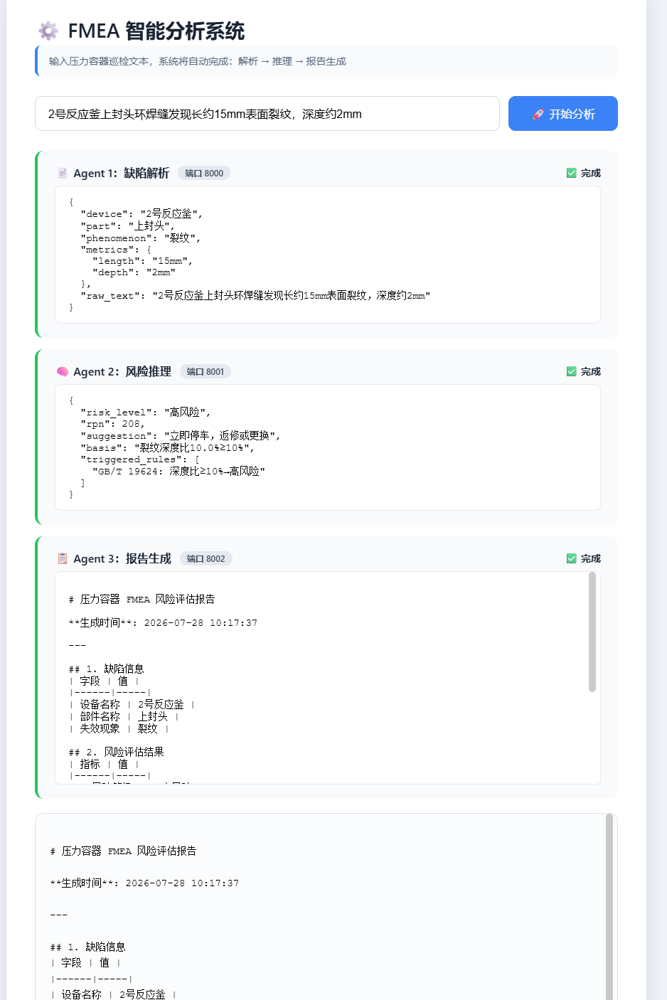
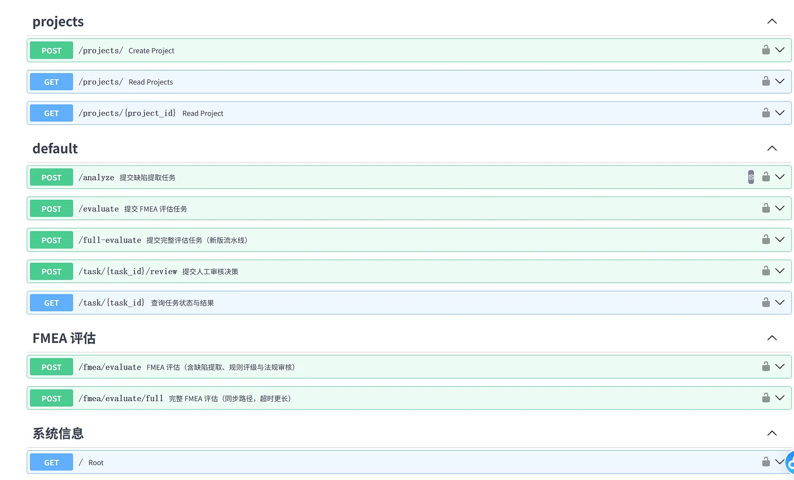
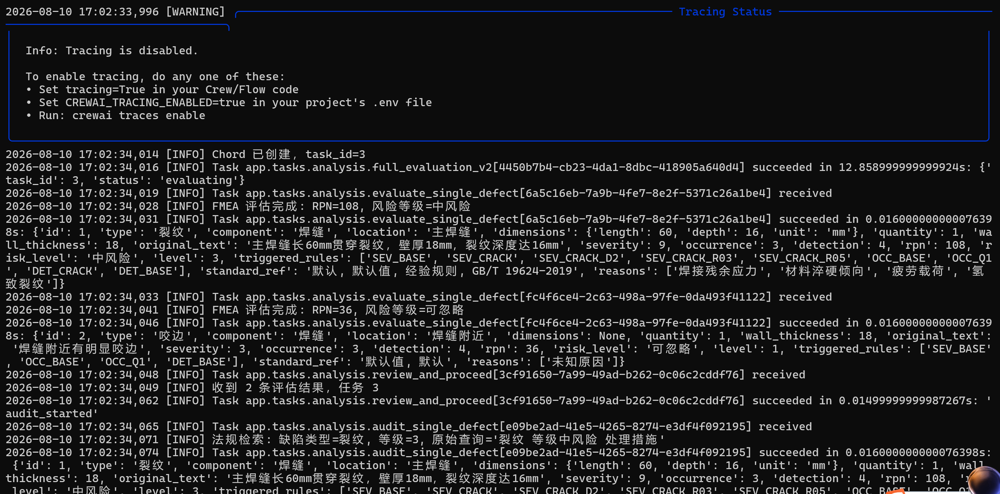
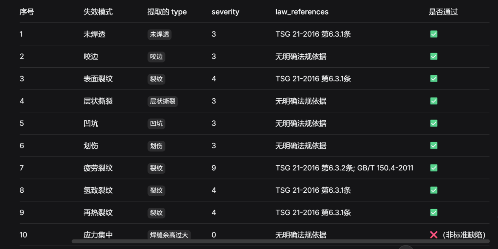

# Demonstration Evidence

These screenshots were captured from the internal development environment.

## 1. System demonstration

The interface shows the end-to-end flow:

- inspection text input
- extraction-agent output
- risk evaluation and RPN
- structured report generation

## 2. API endpoint overview

The FastAPI service exposes endpoints for project management, defect extraction, FMEA evaluation, task status, human review, and system information.

## 3. Asynchronous execution log

The Celery log shows parallel defect evaluation, triggered rule identifiers, RPN results, risk levels, and a human-review workflow. One example reports `RPN=108` and medium risk for a crack defect.

## 4. Extraction and rule check

This table compares extracted defect types against severity values and matched regulation references.

## 5. Screen-recorded demo

[Watch the system demo](videos/fmea_demo.mp4)

Duration: approximately 2 minutes 33 seconds. The recording demonstrates the system interface and the DFMEA / AI-assisted failure-analysis workflow, including RPN evaluation and review-related screens.

## Scope

The evidence demonstrates that the prototype can execute its internal workflow. It does not establish production readiness, external accuracy, or validation by an independent inspection agency.

